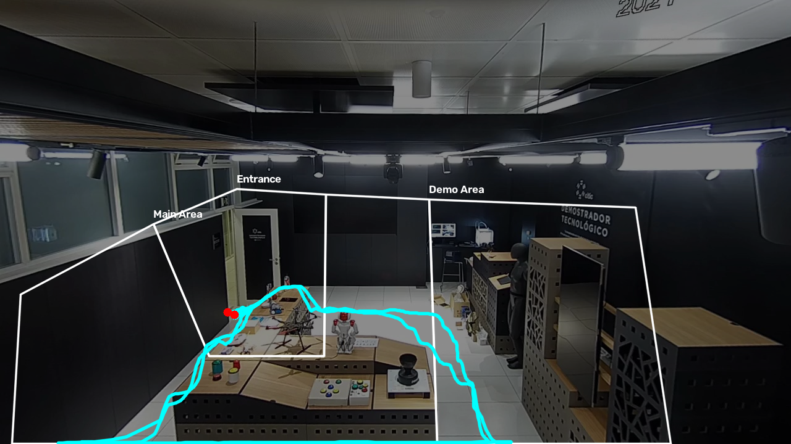
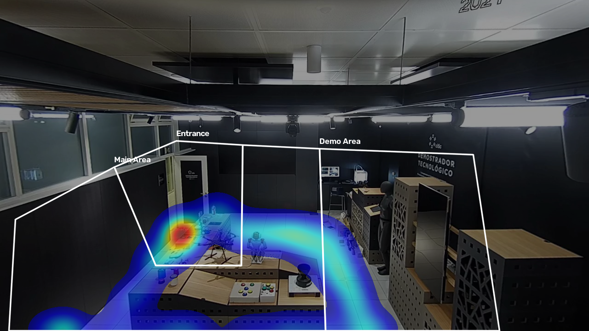

# Retail Customer Tracking & Behavior Analytics

[](https://github.com/ardaatikk/retail-customer-tracking/actions/workflows/ci.yml)
[](https://www.python.org/)
[](https://docs.ultralytics.com/models/yolo11/)
[](https://opencv.org/)
[](tests/)
[](LICENSE)

An end-to-end computer vision pipeline for tracking customers in indoor environments and transforming raw video into interpretable behavioral analytics.

The project supports **single-camera tracking from video files and live RTSP streams**. The CITIC-MTMC Showroom workflow includes zone analysis, trajectory reconstruction, and occupancy heatmaps. Live camera sessions add reconnect handling, optional original-stream recording, and separate raw/confirmed track exports. Multi-camera identity association remains a planned extension.

## Project at a Glance

A single-camera person-tracking system built around two complementary workflows: live RTSP monitoring and repeatable experiments on local video recordings. YOLO11 detects people, ByteTrack associates detections across frames, and a state manager confirms tracks before they enter the primary analytics export.

The engineering work focuses on keeping live capture current, recovering from interrupted streams, comparing model/tracker settings on the same recording, and making each experiment easy to inspect through matching video and Parquet filenames. Public Showroom examples demonstrate spatial analytics; private camera recordings remain local.

| Workflow | Purpose | Outputs |
|---|---|---|
| Live RTSP | Track a camera with latest-frame capture and reconnect handling | Annotated MP4, confirmed/debug Parquet; optional original MKV |
| Local video replay | Repeat a recorded experiment with different models or tracker profiles | Confirmed/debug Parquet, run summary; optional annotated MP4 |
| Showroom dataset | Track the public dataset with calibrated zones | Session video and tables; optional trajectory, heatmap and zone summaries |

### Quick workflow

After installation, run these commands from the repository root. Replace the example RTSP endpoint and local recording path with your own inputs.

```bash
# Live tracking; also retain the original stream for later experiments
python -m src.pipeline.tracking_pipeline \
  --source "rtsp://CAMERA_HOST:PORT/STREAM_PATH" \
  --camera-id live1 --session-name doorway-walk \
  --model yolo11n.pt --tracker-profile recovery --record-stream

# Repeat the experiment from the saved original video, without a camera connection
python -m src.pipeline.replay_pipeline \
  --source /path/to/session_original.mkv \
  --camera-id live1 --session-name doorway-walk-n \
  --model yolo11n.pt --tracker-profile recovery --stride 3 --save-video

# Compare YOLO11s against the same recording in a separate session
python -m src.pipeline.replay_pipeline \
  --source /path/to/session_original.mkv \
  --camera-id live1 --session-name doorway-walk-s \
  --model yolo11s.pt --tracker-profile recovery --stride 3 --save-video
```

Changing model weights does not retrain the detector. Compare the annotated videos, confirmation behavior and replay summaries; a larger model is not automatically better for live tracking when inference is slower. Replay measures behavior on a recording, not RTSP reconnect reliability or camera-to-display latency.

---

## Overview

Traditional object detection can answer **where a person is in a frame**. This project extends that idea into a temporal analytics system capable of answering questions such as:

- How many local tracks were confirmed?
- What was each track's first-to-last observation span?
- Which areas did they visit?
- How much time was spent in each zone?
- What path did each customer follow?
- Which areas accumulated the most customer presence?

The pipeline combines pretrained person detection, multi-object tracking, customer-state management, spatial zones, and analytics into a reproducible workflow.

---

## Features

- Person detection using **pretrained YOLO11n**, with selectable YOLO weights
- RTSP latest-frame capture, bounded reads, and automatic reconnect
- Camera and session-specific output directories
- Optional original RTSP stream recording with FFmpeg
- Separate all-track debug and confirmed-frame exports for live and file sessions
- Selectable baseline and recovery ByteTrack profiles
- Multi-object tracking using **ByteTrack**
- Local track IDs maintained while matching succeeds
- Customer confirmation to reduce short-lived false detections
- Ground-point estimation from person bounding boxes
- Camera-specific polygonal zones
- Zone transition tracking
- Per-zone dwell-time calculation
- Customer trajectory reconstruction
- Occupancy / dwell heatmap generation
- Per-customer behavior summaries
- Per-zone analytics
- Parquet-based structured outputs
- Reproducible CITIC-MTMC dataset download
- Automated unit testing with **122 tests**
- GitHub Actions continuous integration
- Architecture prepared for future multi-camera tracking

> The detector is **not fine-tuned**. YOLO11n is the default; YOLO11s can also be selected. Detection is restricted to the person class. Confirmed track IDs do not establish unique-person identity across tracking losses or camera views.

---

## System Architecture

```text
              Video File / RTSP
                      │
                      ▼
             Pretrained YOLO11
              Person Detection
                      │
                      ▼
                  ByteTrack
                      │
                      ▼
               local_track_id
                      │
                      ▼
            Customer State Manager
                      │
             ┌────────┴────────┐
             ▼                 ▼
       Zone Assignment    Track Storage
             │                 │
             └────────┬────────┘
                      ▼
                 Analytics
          ┌───────────┼───────────┐
          ▼           ▼           ▼
     Trajectory    Heatmap     Summaries
```

Detection, tracking, state management, zone assignment, persistence, and analytics are separated into independent modules so that individual components can be extended without redesigning the complete pipeline.

---

## Example Results

The following outputs were generated from the `Showroom` camera of the CITIC-MTMC dataset.

### Customer Trajectories

Customer movement is reconstructed using the bottom-center point of each tracked bounding box as an approximation of the person's position on the ground plane.



### Occupancy / Dwell Heatmap

Each valid customer position contributes to the heatmap. Areas with higher accumulated presence therefore represent locations where customers spent more observed time.



---

## Example Analytics

For the current `capture1 / Showroom` experiment:

| Metric | Result |
|---|---:|
| Confirmed tracks | 2 |
| Confirmed track points | 944 |
| Spatial analytics points | 696 |
| Bottom-truncated points excluded from spatial analytics | 248 |

### Customer Behavior

| Customer | Observed Time | Zone Path |
|---|---:|---|
| Person #1 | 19.44 s | Entrance → Main Area → Demo Area → Main Area → Entrance |
| Person #2 | 19.92 s | Entrance → Main Area → Demo Area → Main Area → Entrance |

### Zone Analytics

| Zone | Customers | Total Dwell Time | Average Dwell Time |
|---|---:|---:|---:|
| Entrance | 2 | 10.04 s | 5.02 s |
| Main Area | 2 | 18.00 s | 9.00 s |
| Demo Area | 2 | 11.32 s | 5.66 s |

The total measured zone dwell time equals the total confirmed customer observation time for this experiment.

---

## Dataset

This project currently uses the **CITIC-MTMC** indoor multi-camera tracking dataset.

The dataset contains multiple synchronized indoor camera views and provides a suitable environment for developing and evaluating tracking and spatial analytics pipelines.

Current development uses:

```text
capture1
└── Showroom
```

The dataset itself is **not included in this repository**.

Dataset resources:

- Repository: `https://github.com/GTEC-UDC/citic-mtmc-dataset`
- DOI: `10.5281/zenodo.17511785`

The project includes a download utility that retrieves the dataset archive from Zenodo.

---

## Installation

### 1. Clone the repository

```bash
git clone https://github.com/ardaatikk/retail-customer-tracking.git
cd retail-customer-tracking
```

### 2. Create a virtual environment

```bash
python3 -m venv .venv
source .venv/bin/activate
```

### 3. Install dependencies

```bash
python -m pip install --upgrade pip
pip install -r requirements-dev.txt
```

Main dependencies include:

- Ultralytics
- OpenCV
- Pandas
- PyArrow
- Requests
- LAP
- Pytest

Model weights are not stored in the repository. If a named model such as `yolo11n.pt` or `yolo11s.pt` is missing locally, Ultralytics may download it on first use. A local weights path can also be passed with `--model`.

### 4. Optional: install FFmpeg for original-stream recording

FFmpeg is required only for `--record-stream`; ordinary detection/tracking and annotated MP4 recording use OpenCV.

On macOS with Homebrew:

```bash
brew install ffmpeg
ffmpeg -version
```

For other platforms, install FFmpeg using the [official download options](https://ffmpeg.org/download.html) and make sure the `ffmpeg` executable is available on `PATH`.

The CITIC-MTMC dataset and Showroom zone setup below are needed for the dataset example. Live RTSP tracking does not require downloading the dataset.

---

## Dataset Setup

Download the CITIC-MTMC archive:

```bash
python -m src.data.download
```

After downloading, extract the dataset under:

```text
data/raw/citic_mtmc/dataset/
```

The expected structure includes the capture directories and camera videos.

Validate the local dataset:

```bash
python -m src.data.validate
```

A valid installation should detect:

```text
Captures: 3
Cameras per capture: 5
Videos: 15
Ground-truth files: 3
CITIC-MTMC dataset validation passed.
```

Raw datasets are excluded from version control.

---

## Zone Configuration

Zones are represented as camera-specific polygons and stored as JSON configuration files.

The repository already includes the Showroom zone configuration used by the current pipeline:

```text
src/config/zones/Showroom.json
```

The Showroom configuration defines three behavioral areas:

- **Entrance**
- **Main Area**
- **Demo Area**

The video-file workflow loads this configuration and assigns track ground points to zones. **Live RTSP sessions do not load the Showroom polygons**: zone analysis is disabled and exported `zone` values are null. Renaming a live camera does not calibrate its zones.

For a new camera view, zones can be created interactively using:

```bash
python -m src.zones.configure
```

The configuration utility allows polygonal zones to be drawn directly on a camera reference frame and saves the resulting coordinates for use by the tracking pipeline.

The included Showroom configuration is already complete and does not need to be recreated to run the current example.

This camera-specific configuration approach also allows additional zone files to be introduced as the project expands to multiple camera views.

---

## Running the Pipeline

### 1. Dataset Video Tracking

Run the existing `capture1/Showroom.mp4` example:

```bash
python -m src.pipeline.tracking_pipeline
```

The pipeline performs:

```text
Video
  ↓
Person Detection
  ↓
ByteTrack
  ↓
Customer Confirmation
  ↓
Zone Assignment
  ↓
Track Persistence
```

Structured tracking data is written to:

```text
artifacts/sessions/Showroom/<session>/<session>_confirmed_tracks.parquet
artifacts/sessions/Showroom/<session>/<session>_all_tracks_debug.parquet
artifacts/sessions/Showroom/<session>/<session>_annotated.mp4
```

The schema includes fields such as:

```text
camera_id
capture_id
frame_id
timestamp
local_track_id
customer_id
bounding box
ground point
zone
confidence
```

Generated videos and processed datasets are excluded from Git.

### 2. Analytics

After processing the **Showroom dataset video**, select the confirmed table printed by the tracking run:

```bash
python -m src.pipeline.analytics_pipeline \
  --tracks artifacts/sessions/Showroom/SESSION_ID/SESSION_ID_confirmed_tracks.parquet \
  --reference-frame src/config/reference_frames/Showroom.jpg
```

Replace both `SESSION_ID` placeholders with the generated session name. Analytics are written to that session’s `analytics/` directory: customer and zone summaries, plus trajectory and heatmap figures when a suitable reference frame is supplied. Zone summaries require zone assignments in the track data. The no-argument analytics command reads only the legacy export location; it does not automatically select a new session.

---

## Live RTSP Tracking

Run a single camera with the lightweight model and recovery profile:

```bash
python -m src.pipeline.tracking_pipeline \
  --source "rtsp://CAMERA_HOST:PORT/STREAM_PATH" \
  --camera-id live1 \
  --model yolo11n.pt \
  --tracker-profile recovery
```

Replace the placeholder URL with the camera's actual RTSP endpoint. Commands are run from the repository root with the Python environment activated.

| Option | Behavior |
|---|---|
| `--source` | Video path or RTSP URL. Omitted: the original Showroom dataset video. |
| `--camera-id` | Output camera label. Live default: `live1`; file default: `Showroom`. |
| `--model` | Named YOLO weights or local weights path. Default: `yolo11n.pt`. |
| `--tracker-profile` | `auto`, `baseline`, or `recovery`. `auto` selects recovery for live sources and baseline for files. |
| `--session-name` | Optional descriptive label shared by the session folder and filenames. |
| `--record-stream` | Also record the original RTSP video to MKV using FFmpeg stream copy. |

**Controls:** Space pauses/resumes processing; Q exits normally and saves the track tables. While processing is paused, live capture continues reading the camera; an enabled original-stream recording also continues.

### Capture and recovery

The background reader retains one latest frame. A slow consumer skips intermediate frames instead of accumulating a processing backlog. RTSP uses the FFmpeg backend with TCP transport and open/read timeouts. A failed RTSP read invalidates the stored frame and triggers repeated connection attempts. Consumer timeouts are retried by the pipeline.

Frame IDs remain monotonic across reconnects. This does not guarantee that the person's tracker ID survives a network outage. The reconnect implementation is covered by fake-capture tests; a real camera disconnect/recovery test has not yet been completed.

### Model choice

Both models use pretrained weights; this project has not added camera-specific training.

| Model | Findings from the development recording |
|---|---|
| `yolo11n.pt` | Lightweight default retained for live use; some difficult walking frames were missed. |
| `yolo11s.pt` | Detected a person in some frames missed by nano and reduced some coat-rack detections, but took longer to process. A live trial showed worse green-box continuity, so it remains an optional comparison model. |

These are observations from one recording and live trial, not a general accuracy benchmark. Better detection on individual frames does not guarantee better live tracking when fewer frames can be processed.

To compare small without running an additional detector:

```bash
python -m src.pipeline.tracking_pipeline \
  --source "rtsp://CAMERA_HOST:PORT/STREAM_PATH" \
  --camera-id live1 \
  --model yolo11s.pt \
  --tracker-profile recovery
```

Only one YOLO model runs in the tracking pipeline. The previous debug-detections mode has been removed.

### Recovery profile

The tested configuration is stored in `src/config/trackers/bytetrack_recovery.yaml`:

| Setting | Value |
|---|---:|
| Detector confidence threshold | 0.10 |
| `track_high_thresh` | 0.50 |
| `track_low_thresh` | 0.10 |
| `new_track_thresh` | 0.60 |
| `track_buffer` | 30 |
| `match_thresh` | 0.85 |
| `fuse_score` | true |

Low-confidence detections can help continue an existing track, while creating a new track requires a stronger detection. The profile improved ID continuity in sampled replay tests; very low processing rates still caused losses. This profile is not a guarantee against false positives or ID changes. Parameter meanings are described in the [Ultralytics tracking documentation](https://docs.ultralytics.com/modes/track/).

Use `--tracker-profile baseline` to restore the original tracking settings. Customer confirmation is a separate step and still applies its observation, movement, and average-confidence requirements.

### Session outputs

Each session ID contains the camera, mode (`live`, `file` or `replay`) and readable date/time in Europe/Istanbul, without a random suffix. An optional `--session-name doorway-walk` adds a descriptive label. Videos and tables share this prefix so they can be matched directly; an existing session directory causes an error instead of being overwritten:

```text
artifacts/sessions/live1/<session>/
├── <session>_confirmed_tracks.parquet
├── <session>_all_tracks_debug.parquet
├── <session>_annotated.mp4
└── <session>_original.mkv       # only with --record-stream
```

The annotated MP4 contains the processed frames, green boxes for confirmed tracks, person labels, and elapsed time. It is written at the camera FPS. If processing skips frames, parts of this video can play faster than real time.

For an original recording independent of detection's frame skipping, add:

```bash
python -m src.pipeline.tracking_pipeline \
  --source "rtsp://CAMERA_HOST:PORT/STREAM_PATH" \
  --camera-id live1 \
  --model yolo11n.pt \
  --tracker-profile recovery \
  --record-stream
```

FFmpeg opens a second RTSP connection and copies the compressed video stream without re-encoding it. The MKV contains no detection boxes and uses the source timestamps. Camera/network failures can still interrupt it. Additional network and disk activity can affect performance.

If original-stream recording stops, the pipeline prints a warning and detection continues. That recorder does not reconnect automatically. Use Q to close it normally. A compatible player is needed for MKV; convert a completed recording to MP4 without re-encoding if required:

```bash
ffmpeg -i path/to/session_raw.mkv -map 0:v:0 -c:v copy \
  -movflags +faststart path/to/session_raw.mp4
```

### Raw and confirmed Parquet tables

`<session>_all_tracks_debug.parquet` contains every observation returned by the tracker, including unconfirmed tracks. `<session>_confirmed_tracks.parquet` contains only observations that were already confirmed when processed, matching green-box frames. Unconfirmed tracks and pre-confirmation observations are excluded from this primary file. Their full histories remain in the clearly named debug table; a `first_seen` metadata column preserves the original start time for duration analysis.

Both tables retain camera/session/frame/track identifiers, timestamps, bounding-box coordinates, ground points, confidence, and zone. Additional fields distinguish the confirmation stages:

| Field | Meaning |
|---|---|
| `customer_id` | Raw: ID assigned at observation time, otherwise null. Confirmed history: final assigned ID on all rows. |
| `confirmed_at_frame` | Whether that track was already confirmed at this observation. Always true in new primary confirmed exports. |
| `first_seen` | Original first observation timestamp, retained even when earlier rows are omitted from the primary export. |
| `confirmed_at` | Session time in seconds when the track was confirmed; null if it never was. |
| `final_customer_id` | ID assigned by session end; null for tracks that remain unconfirmed. |

Compare tables using `camera_id`, `capture_id`, `local_track_id`, and `frame_id`. Primary confirmed rows have `confirmed_at_frame=True` and a non-null `customer_id`. The video label uses `customer_id`, not `local_track_id`: local track 12 can appear as Person #1. The debug file is for diagnostics and can contain invisible/unconfirmed tracks.

An observation is added only when the tracker returns a track. Frames with no tracks and network timeouts do not produce event rows. Empty sessions produce two empty live-session tables; sessions without confirmations produce an empty confirmed table.

Legacy single `tracks.parquet` files may contain unconfirmed tracks and lack frame-time confirmation flags; they are not automatically rewritten. Track rows accumulate in memory and are saved on normal exit. An abrupt process termination can lose these rows. File runs, including Showroom, now write an annotated video and separate confirmed/debug tables into `artifacts/sessions/<camera>/<session>/`. File decoding, tracking defaults and zone handling are unchanged.

### Analyze a live-session export

Select the confirmed history file and its camera/session:

```bash
python -m src.pipeline.analytics_pipeline \
  --tracks artifacts/sessions/live1/SESSION_ID/SESSION_ID_confirmed_tracks.parquet \
  --camera-id live1 \
  --capture-id SESSION_ID
```

Replace `SESSION_ID` with the actual directory/session ID. Camera and capture IDs can be omitted when the input contains exactly one camera/session. An ambiguous input requires explicit selection; local person IDs from different sessions are not merged.

| Analytics option | Behavior |
|---|---|
| `--tracks` | Input Parquet. Omitted: the original Showroom `tracks.parquet` workflow. |
| `--camera-id` | Select one camera. Inferred for a single-session custom input. |
| `--capture-id` | Select one capture/session. Inferred for a single-session custom input. |
| `--output-dir` | Where summaries and optional figures are written. Custom input default: an `analytics/` directory beside the input. |
| `--reference-frame` | Same-camera image at the original recorded resolution, enabling spatial plots for custom inputs. |

For custom inputs, `customer_summary.parquet` reports each confirmed track's first/last times and observation span. `zone_summary.parquet` is generated only when the selected observations contain zone assignments. A zone-free RTSP session prints a skipped message.

Custom inputs do not use the Showroom background. Without `--reference-frame`, trajectory and heatmap are skipped while the track summary is still produced. With a matching reference image, both figures can be generated without a zone configuration:

```bash
python -m src.pipeline.analytics_pipeline \
  --tracks artifacts/sessions/live1/SESSION_ID/SESSION_ID_confirmed_tracks.parquet \
  --camera-id live1 \
  --capture-id SESSION_ID \
  --reference-frame path/to/live1_reference.png \
  --output-dir artifacts/sessions/live1/SESSION_ID/analytics
```

Ground points use original image pixels; a resized or different-camera reference is unsuitable. A matching camera-specific zone configuration, if present, is used for figure overlays and dimension checks; it does not recompute missing zone values in the Parquet input.

Raw split exports are also accepted: their `final_customer_id` selects confirmed histories while retaining pre-confirmation observations. Tracks that remain unconfirmed are excluded. Prefer the confirmed file for ordinary analytics. Missing selections, mixed unresolved sessions, and inputs without confirmed tracks are reported as errors.

Custom output files use `customer_summary.parquet`, optional `zone_summary.parquet`, `trajectory.png`, and `heatmap.png`. Reusing an output directory can overwrite files generated by the current run; files for skipped reports are not deleted. Use separate directories for separate comparisons.

---

## Spatial Analytics

Bounding-box center coordinates are useful for visualization, but they do not accurately represent a person's position on the floor.

For spatial analytics, this project therefore uses:

```text
ground_x = (x1 + x2) / 2
ground_y = y2
```

which approximates the person's ground contact point.

When a bounding box is clipped exactly at the bottom edge of the frame, the resulting ground point does not reliably represent the person's feet. These samples remain available for tracking and temporal analytics but are excluded from trajectory and heatmap generation.

This separation prevents spatial artifacts without discarding valid customer observation time.

---

## Customer Confirmation

Raw tracker IDs are not automatically treated as customers.

A track must satisfy multiple conditions before being confirmed, including:

- Minimum observation duration
- Minimum displacement
- Minimum number of movement frames
- Minimum average detection confidence

This helps suppress short-lived false detections and static objects incorrectly detected as people.

Once confirmed, the track receives a sequential customer identifier while preserving its original `local_track_id`. Its `confirmed_at` timestamp is recorded once.

Current confirmation requires at least 0.5 seconds of observation, 10 pixels of maximum displacement, five movement observations with steps of at least 2 pixels, and average confidence of at least 0.50. A stationary person may therefore remain unconfirmed even when detected.

The displayed store time and final observed time represent an elapsed span from first observation, not the sum of continuously visible intervals. Tracking losses and pauses can contribute to that span. `Confirmed tracks` counts accepted local tracks, not verified unique people.

---

## Testing

Run the test suite with:

```bash
pytest -q
```

Current test suite:

```text
122 passed
```

Tests cover:

- Tracking geometry
- Customer-state management
- Customer confirmation
- Zone assignment
- Zone dwell times
- Analytics summaries
- Dataset validation
- Parquet track persistence
- Detector behavior with mocked YOLO inference
- Latest-frame skipping and duplicate-frame prevention
- RTSP reconnect, stale-frame invalidation, timeouts, and shutdown with fake captures
- Independent stream-recording process lifecycle with mocked FFmpeg
- Live/file pipeline behavior and model/profile selection
- Raw/confirmed Parquet consistency and confirmation timestamps
- Analytics camera/session selection, ID reuse isolation, raw history selection, and zone-free output
- Offline replay outputs, native video dimensions, frame sampling, timestamps, and safe cleanup with synthetic frames

Network access, a camera, FFmpeg, and real model inference are not required by the unit tests. The 122-test result was verified locally on 12 October 2026. The CI badge above reports the current GitHub workflow status; this local result is not a live CI report.

### Manual camera checks

These tools run only when invoked explicitly and are not discovered as pytest tests:

```bash
python tests/integration/rtsp_latest_frame_check.py \
  --source "rtsp://CAMERA_HOST:PORT/STREAM_PATH" \
  --iterations 20 --processing-delay 0.1

python tests/integration/rtsp_reconnect_check.py \
  --source "rtsp://CAMERA_HOST:PORT/STREAM_PATH"
```

The latest-frame check is a short live-stream inspection, not a camera-to-display latency measurement. The reconnect check keeps requesting frames during an outage; interrupt it with Ctrl+C. A portable replay tool accepts your own local recording. No private camera recording is included or needed by CI.

### Recorded-camera replay

Run from the repository root with local YOLO weights available:

```bash
python -m src.pipeline.replay_pipeline \
  --source /path/to/local_recording.mkv \
  --camera-id camera1 \
  --model yolo11n.pt \
  --tracker-profile recovery \
  --stride 3
```

The manual integration wrapper provides the same interface:

```bash
python tests/integration/recorded_camera_check.py \
  --source /path/to/local_recording.mkv --camera-id camera1 --stride 3
```

This is a local video replay, not a live camera connection. A stride of 3 processes every third source frame: about 8 observations per second for a 24 FPS recording. `--max-frames 80` limits the run to 80 processed frames. Use `--tracker-profile baseline` or `--model yolo11s.pt` for a separate comparison run; only one model runs at a time. Recorded replay does not test network reconnect or variable live processing delays.

Live and replay runs share the `artifacts/sessions/<camera>/<session>/` layout. Each replay run writes to a new session directory by default:

```text
<session>_all_tracks_debug.parquet
<session>_confirmed_tracks.parquet
summary.json
<session>_annotated.mp4       # only when --save-video is supplied
```

Use `--output-dir /path/to/new_output_directory` to choose another local destination. Existing destinations are rejected rather than overwritten. Parquet export consistency is checked before the run is reported as successful. The summary includes processed-frame counts, confirmation times and first-to-last track spans; it records source/model filenames rather than absolute local paths.

Video generation is opt-in with `--save-video`. The output preserves the source frame dimensions and writes at the sampled FPS, so processing speed does not accelerate it. Irregular source timestamps can still differ from a constant-FPS preview. MP4 playback support depends on the OpenCV codec; convert a completed preview to H.264 if needed:

```bash
ffmpeg -i path/to/session_annotated.mp4 -c:v libx264 \
  -pix_fmt yuv420p -movflags +faststart path/to/replay_h264.mp4
```

No zone overlay is used in replay. Stationary people may remain unconfirmed under the existing movement requirements. Observation spans include gaps; confirmed IDs are not verified unique people.

### Camera media and repository contents

Private camera recordings and screenshots stay local and are not used in README examples or included with tests. Common video/image extensions and default replay outputs are ignored by Git. The included Showroom reference image and analytics figures are public CITIC-MTMC examples and remain included.

Parquet tables are not covered by the private-image restriction. Generated data stays ignored under the existing raw/processed-data and replay-output rules; any selected publishable data example should be reviewed separately. CI tests use synthetic frames and mocked inference, with no real camera image or video fixture.

---

## Continuous Integration

GitHub Actions is configured to run the unit test suite automatically on:

- Pushes to `main`
- Pull requests targeting `main`

The CI environment installs the development dependencies and runs:

```bash
pytest -q
```

---

## Project Structure

```text
retail-customer-tracking/
├── .github/
│   └── workflows/
│       └── ci.yml
├── artifacts/
│   ├── figures/
│   ├── videos/
│   └── sessions/
│       └── <camera>/<session>/
├── data/
│   ├── processed/
│   └── raw/
├── src/
│   ├── analytics/
│   │   ├── input.py
│   │   ├── heatmap.py
│   │   ├── summary.py
│   │   └── trajectory.py
│   ├── config/
│   │   ├── trackers/
│   │   │   └── bytetrack_recovery.yaml
│   │   ├── reference_frames/
│   │   ├── zones/
│   │   ├── paths.py
│   │   └── settings.py
│   ├── data/
│   │   ├── download.py
│   │   ├── track_writer.py
│   │   └── validate.py
│   ├── detection/
│   │   └── detector.py
│   ├── pipeline/
│   │   ├── analytics_pipeline.py
│   │   ├── replay_pipeline.py
│   │   └── tracking_pipeline.py
│   ├── tracking/
│   │   ├── customer_state.py
│   │   └── tracker.py
│   ├── video/
│   │   ├── source.py
│   │   ├── session.py
│   │   └── recorder.py
│   ├── visualization/
│   │   └── draw.py
│   └── zones/
│       ├── configure.py
│       └── zone_manager.py
├── tests/
│   ├── integration/
│   │   ├── recorded_camera_check.py
│   │   ├── rtsp_latest_frame_check.py
│   │   └── rtsp_reconnect_check.py
│   └── unit/
├── .gitignore
├── LICENSE
├── README.md
├── requirements-dev.txt
└── requirements.txt
```

---

## Design Decisions

### Pretrained Detection

YOLO11n is the default pretrained detector. YOLO11s or local compatible detection weights can be selected with `--model`; no domain-specific fine-tuning is included.

This keeps the current project focused on tracking, behavioral analytics, and system design. Domain-specific detector fine-tuning can be introduced later if real deployment footage reveals significant detection limitations.

### Local Track IDs

Tracker-generated identifiers are explicitly represented as:

```text
local_track_id
```

rather than global customer identities.

This distinction is intentional and prepares the data model for future multi-camera tracking.

### Camera-Specific Tracking

Tracking state belongs to an individual video stream. Each camera therefore requires an independent tracker instance.

Analytics modules are designed to consume structured tracking records rather than depending directly on a specific camera implementation.

---

## Multi-Camera Roadmap

The Showroom video-file workflow provides single-camera analytics. Live RTSP capture, tracking, and session exports are also available. The analytics CLI accepts their confirmed histories; spatial plots require a reference frame from the selected camera.

The next development milestone is multi-camera customer tracking using the remaining CITIC-MTMC camera views.

Planned architecture:

```text
Camera 1 ─→ YOLO ─→ ByteTrack ─→ Local Tracks ─┐
Camera 2 ─→ YOLO ─→ ByteTrack ─→ Local Tracks ─┤
Camera 3 ─→ YOLO ─→ ByteTrack ─→ Local Tracks ─┼─→ Cross-Camera Association
Camera 4 ─→ YOLO ─→ ByteTrack ─→ Local Tracks ─┤            │
Camera 5 ─→ YOLO ─→ ByteTrack ─→ Local Tracks ─┘            ▼
                                                       global_track_id
                                                              │
                                                              ▼
                                                       Global Analytics
```

Planned extensions include:

- Processing all five camera views
- Per-camera tracker instances
- Person Re-Identification embeddings
- Temporal cross-camera constraints
- Camera-topology-aware association
- Global customer identities
- Cross-camera trajectories
- Camera transition analytics
- Global visit-duration estimation
- Multi-camera behavioral summaries

The existing `camera_id` and `local_track_id` fields are intentionally preserved to support this extension without redesigning the tracking data model.

---

## Limitations

The current implementation has several intentional limitations:

- Tracking is currently performed on a single camera.
- Customer IDs are session-level identifiers, not cross-camera identities.
- YOLO11n uses pretrained weights without domain-specific fine-tuning.
- Store time is the first-to-last observation span within the current camera; it can include gaps and is not continuous visible time or complete visit duration.
- Ground position is approximated from the bottom-center of the bounding box rather than projected into a calibrated world coordinate system.
- Zone definitions are manually configured per camera; live RTSP zone analysis is currently disabled.
- A lost/recreated track can assign a new customer ID to the same person.
- Low processing FPS can break ID continuity even with recovery settings.
- Annotated live MP4 recordings can appear accelerated when intermediate frames are skipped.
- Track tables are written on normal exit, not periodically during a session.
- Original-stream recording requires FFmpeg and does not reconnect automatically.
- The analytics command defaults to the original Showroom example; live sessions must be selected explicitly with `--tracks`.
- Heatmaps represent accumulated observed presence rather than unique-person density.

These limitations define the next stages of development rather than being hidden assumptions of the system.

---

## License

This project is licensed under the **MIT License**.

See [LICENSE](LICENSE) for details.

---

## Author

**Arda Atik**

Artificial Intelligence Engineer
Readable recording label example: add `--session-name doorway-walk` to either the live or replay command. Videos and Parquet files then share a camera/label/date prefix. Existing recordings remain untouched unless explicitly migrated. Legacy files without frame-time confirmation flags can only be filtered by final assigned customer IDs; exact green-box start frames cannot be reconstructed.

## Session folder layout

Each live or replay session keeps its videos, clean Parquet, debug Parquet and optional summary together under `artifacts/sessions/<camera>/<session>/`. Live sessions normally contain two tables and one annotated video; `--record-stream` adds the original MKV. Replay produces two tables and summary.json; `--save-video` adds a video. A run with no decoded frames may have no video. Explicit replay --output-dir still overrides this location.

Generated session bundles are local and ignored by Git. Showroom uses the same session layout under `artifacts/sessions/Showroom/`; dataset input and tracking behavior are unchanged. Older outputs can be consolidated into this layout with verified copies; source files are retained in a local `artifacts/session_archive/` tree for rollback. Legacy data without frame-time confirmation flags is filtered by final assigned customer IDs, not reconstructed green-frame timing. Migration details live beside the consolidated session. Missing historical videos or Parquet inputs are recorded rather than fabricated.

### Showroom session outputs

Each Showroom run has its own directory in `artifacts/sessions/Showroom/`, containing `<session>_annotated.mp4`, `<session>_confirmed_tracks.parquet`, and `<session>_all_tracks_debug.parquet`. For analytics, pass that session’s confirmed table with `--tracks`; the legacy default input remains available only for older exports. `data/raw/` remains the dataset input location.
